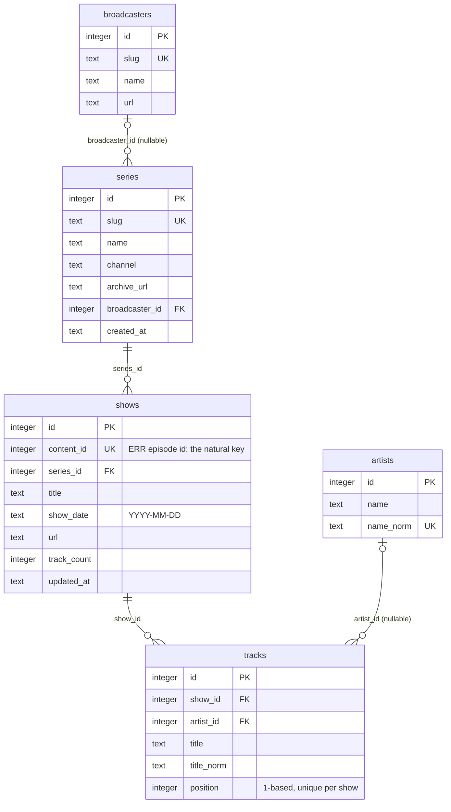

# Database structure

Data lives in five places, and they are deliberately kept apart:

| Store | What it holds | Where | Written by |
| --- | --- | --- | --- |
| **The archive** | series, shows, tracks, artists, broadcasters | `data/tracklists.sqlite`, committed, copied into the image | `npm run build:db` only; read-only at runtime |
| **The annotation store** | one person's good / notes / want-to-listen per show | Firestore in production, `data/annotations.sqlite` locally | the API, on every annotation write |
| **The annotation temp table** | a copy of the owner's annotations for joining | a `TEMP TABLE` on the archive connection, in process | loaded at boot, updated after each successful store write |
| **The favourites store** | one person's list of shows, songs, artists and albums to follow up on | Firestore in production, the same `data/annotations.sqlite` locally | the API, on every favourites write |
| **The favourites cache** | a copy of the owner's favourites for reads and membership | a `Map` in process | loaded at boot, updated after each successful store write |

The split exists because the archive is rebuilt wholesale from scrape output.
Anything personal kept inside it would be destroyed on the next rebuild, so
annotations live elsewhere and are joined on at query time. The README covers
the operations side (scripts, deploy, variables); this document is the
reference for what is in each store and why it is shaped that way.

Everything below is taken from `server/src/schema.sql`, `server/src/build-db.js`,
`server/src/importer.js`, `server/src/normalize.js`, `server/src/routes.js` and
`server/src/annotations/` and `server/src/favourites/`. When this document and the code disagree, the code
is right and this document needs fixing.

---

## 1. The archive

A single SQLite file, opened through `better-sqlite3` (synchronous API). The
server opens it with `readonly: true, fileMustExist: true` and never writes to
it. There is one connection per process, shared by every route.

### Size and contents

Figures from the archive committed in September 2026. `GET /api/stats` reports
the live numbers.

| Table | Rows |
| --- | ---: |
| series | 7 |
| shows | 2,696 |
| tracks | 38,146 |
| artists | 19,563 |

The file is about 4.6 MB (1,134 pages of 4 KiB). Per series:

| Series | Shows | Tracks | Shows with no tracklist | First | Last |
| --- | ---: | ---: | ---: | --- | --- |
| Eesti Pops | 204 | 2,311 | 52 | 2021-08-24 | 2026-09-08 |
| Fantaasia | 1,940 | 28,165 | 618 | 2015-10-12 | 2026-09-10 |
| Popikroonikad | 241 | 3,817 | 21 | 2017-09-07 | 2026-05-31 |
| Sander Varusk | 148 | 2,144 | 2 | 2025-05-14 | 2026-09-10 |
| Varuski Teematund | 49 | 646 | 1 | 2024-05-08 | 2026-09-12 |
| Vibratsioon | 14 | 190 | 0 | 2023-09-14 | 2023-12-14 |
| Xx Sajandi Popmuusika | 100 | 873 | 35 | 2024-07-06 | 2026-09-12 |

The 729 shows with no tracklist are real episodes whose page on ERR had no
track listing. They are kept so the gaps in the archive stay visible.

### Entity diagram



### `broadcasters`

Who puts a series out. Today there is one row, ERR. Defined in
`data/broadcasters.json`, keyed by slug, and inserted by the build.

| Column | Type | Constraints | Meaning |
| --- | --- | --- | --- |
| `id` | INTEGER | primary key | assigned at build time |
| `slug` | TEXT | not null, unique | the key `series.json` refers to, e.g. `err` |
| `name` | TEXT | not null | display name, e.g. `ERR`; a missing name fails the build |
| `url` | TEXT | nullable | the broadcaster's home page |

### `series`

One row per radio show (the programme, not the episode).

| Column | Type | Constraints | Meaning and source |
| --- | --- | --- | --- |
| `id` | INTEGER | primary key | assigned at build time |
| `slug` | TEXT | not null, unique | from the CSV filename: `eesti_pops_tracks.csv` gives `eesti_pops`; lowercased |
| `name` | TEXT | not null | display name, derived from the CSVs (see the note below) |
| `channel` | TEXT | nullable | reserved for the station (Raadio 2, Klassikaraadio); nothing sets it today, every row is NULL |
| `archive_url` | TEXT | nullable | the series' archive page on the broadcaster's site, from `series.json` |
| `broadcaster_id` | INTEGER | nullable, references `broadcasters(id)` | resolved from the `broadcaster` slug in `series.json`; NULL when the key is absent or null |
| `created_at` | TEXT | not null, default now | when the row was created during the build, not a broadcast date |

**How `name` is derived.** The importer sets it from the file it is reading. For
a tracks file it is the first row's show title cut at the first `.` or `:`, so
`Eesti Pops. Suvi 2024` gives `Eesti Pops`. For a shows file it is the slug
with underscores and hyphens turned into spaces and each word capitalised.
Shows files are imported after tracks files, and the series upsert overwrites
`name` each time, so every series that has a shows file ends up with the
capitalised slug. That is why the archive says `Xx Sajandi Popmuusika` rather
than `XX sajandi popmuusika`. `series.json` has no `name` key; adding one would
be the natural place for an override.

### `shows`

One row per episode. Indexes: `idx_shows_date` on `(show_date)` and
`idx_shows_series_date` on `(series_id, show_date)`, which serve the per-series
listing and the date-range filter on tracks.

| Column | Type | Constraints | Meaning and source |
| --- | --- | --- | --- |
| `id` | INTEGER | primary key | assigned at build time; **not stable across rebuilds**, see Keys below |
| `content_id` | INTEGER | not null, unique | ERR's own episode id, from the `content_id` column of a tracks CSV or parsed out of the show URL (`https://r2.err.ee/1610128043/...` gives `1610128043`). The natural key. |
| `series_id` | INTEGER | not null, references `series(id)`, cascade on delete | the series the episode belongs to |
| `title` | TEXT | not null | the show title as scraped; falls back to the capitalised slug if blank |
| `show_date` | TEXT | nullable | `YYYY-MM-DD`, converted from the CSV's `dd.mm.yyyy`; NULL when the CSV had `?` or junk (no row is NULL today). Compared as text, which works because of the fixed format. |
| `url` | TEXT | nullable | the episode page on ERR (no row is NULL today) |
| `track_count` | INTEGER | not null, default 0 | number of tracks: the group size for a tracks file, the scraped count for a shows file. Kept so episodes with no tracklist still show a count of 0 rather than vanishing. |
| `updated_at` | TEXT | not null, default now | last touched by the build |

### `artists`

Deduplicated performer names.

| Column | Type | Constraints | Meaning |
| --- | --- | --- | --- |
| `id` | INTEGER | primary key | assigned at build time |
| `name` | TEXT | not null | the name as ERR printed it, from the first row that introduced it |
| `name_norm` | TEXT | not null, unique | `norm(name)`: the deduplication key and the search column |

Two spellings that differ only in case or spacing collapse into one artist
(`Mägi` and `MÄGI` are one row). Spellings that differ in punctuation do not:
`You've Got Me Beat` and `Youve Got Me Beat` are two artists. True
deduplication would be a later pass over this table.

### `tracks`

One row per play. Index: `idx_tracks_artist` on `(artist_id)`, which serves the
artist page and the artist ranking.

| Column | Type | Constraints | Meaning |
| --- | --- | --- | --- |
| `id` | INTEGER | primary key | assigned at build time |
| `show_id` | INTEGER | not null, references `shows(id)`, cascade on delete | the episode |
| `artist_id` | INTEGER | nullable, references `artists(id)`, set null on delete | NULL where ERR left the artist blank (one row today) rather than dropping the track |
| `title` | TEXT | not null | the track title as scraped |
| `title_norm` | TEXT | not null | `norm(title)`, the search column |
| `position` | INTEGER | not null, unique with `show_id` | 1-based play order within the episode, taken from row order in the CSV |

### Keys and identity

`content_id` is the only identifier that survives a rebuild. Every `id` column
is assigned fresh each time the archive is built, so a show that was `id = 42`
can be `id = 43` after a re-scrape adds an older episode before it. The build
is deterministic for identical inputs, but inputs change.

Consequences:

- The API's read routes take `shows.id` and `artists.id` in their URLs, which is
  fine for links within one deployed archive.
- Anything stored outside the archive must key on `content_id`. The annotation
  layer does exactly that, and its write routes take `:contentId`, not `:id`.
- There is no stable id for an artist or a track at all. Nothing outside the
  archive refers to them.

### Search and the `_norm` columns

`norm()` in `normalize.js` trims, lowercases with JavaScript's Unicode-aware
`toLowerCase()`, and collapses runs of whitespace to one space. Nothing else:
diacritics stay, because `õ`, `ä`, `ö` and `ü` are distinct Estonian letters and
`magi` must not find `Mägi`.

SQLite's `LIKE` folds case for ASCII only, so a plain `LIKE` would miss `Õhtu`
when searching for `õhtu`. Both search routes therefore apply `norm()` to the
query and match it against the precomputed `title_norm` and `name_norm`
columns with `LIKE ? ESCAPE '\'`. The needle is escaped with `likeEscape()`,
so a search for `50%` matches a literal percent sign instead of everything.

There is no full-text index. Searches are `LIKE '%needle%'` scans over 38k
rows, which is fast enough at this size.

### What the archive does not record

- Station or channel: the column exists, nothing fills it.
- Any per-user data: see the annotation layer.
- Timestamps that mean anything about the broadcast: `created_at` and
  `updated_at` are build-time bookkeeping.

---

## 2. How the archive is built

`npm run build:db` runs `server/src/build-db.js`, which:

1. Creates `data/tracklists.sqlite.building` from scratch, turns foreign key
   enforcement on for that connection, and applies `schema.sql`.
2. Lists `data/csv/*.csv`, sorted so that every `*_tracks.csv` comes before every
   `*_shows.csv`, alphabetically within each group. Tracks first because the
   shows files add the episodes that have no tracklist, and those must land on
   top of the shows the tracks files already created.
3. Imports each file inside one transaction per file (see below). A file whose
   header row it cannot classify, or whose import fails inside its
   transaction, aborts the build.
4. Inserts the rows of `data/broadcasters.json`, then applies `data/series.json`
   to the series the CSVs created: `archive_url` and `broadcaster_id`. A series
   slug that matches nothing imported, a broadcaster slug that is not in
   `broadcasters.json`, or a broadcaster with no name all abort the build.
5. Refuses to ship a database with zero tracks.
6. `VACUUM`s, closes, and renames the `.building` file into place.

A failure anywhere leaves no file behind: the `.building` file is removed and
whatever `tracklists.sqlite` existed before is untouched.

### What one CSV import does

The importer classifies a file by its header row: `artist`, `title` and
`content_id` make it a tracks file; `show_title` and `track_count` make it a
shows file. The series slug comes from the filename.

For a **tracks file**, rows are grouped by `content_id`, preserving file order
as play order. For each group the show is upserted and its tracks are deleted
and re-inserted. Artists are resolved in one pass: insert-or-ignore on
`name_norm`, then look up the id.

For a **shows file**, each row upserts a show with the scraped `track_count` and
no tracks. The `content_id` is parsed out of `show_url`; rows without one are
skipped and counted.

The upsert rules are what make re-running the build safe:

| Table | On conflict | Effect |
| --- | --- | --- |
| `series` (on `slug`) | update `name` | the last file imported for a series wins the name (see the `name` note above) |
| `shows` (on `content_id`) | update everything, but `show_date` and `url` only if the new value is not NULL | a shows file cannot blank a date a tracks file already set |
| `tracks` | delete all rows for the show, then insert | re-importing never duplicates a track |
| `artists` (on `name_norm`) | do nothing | the first spelling seen is the one kept |

### Schema versus the committed file

The committed `tracklists.sqlite` is whatever the last person with the CSVs
built. It can lag `schema.sql`, and right now it does: the file was built
before the `broadcasters` table and `series.broadcaster_id` were added, so it
has the four older tables and their three indexes and nothing else. Nothing at
runtime reads the new table yet, so the server is unaffected. Before any route
or page starts reading broadcasters, rebuild with the CSVs and commit the
result.

To check what a given archive actually contains:

```bash
node -e "const D=require('better-sqlite3');const d=new D('data/tracklists.sqlite',{readonly:true});console.log(d.prepare(\"select type,name from sqlite_master where name not like 'sqlite_%' order by 1,2\").all())"
```

---

## 3. Runtime access

`db.js` opens the archive once at boot. The path comes from `DB_PATH`,
defaulting to `data/tracklists.sqlite` relative to the repo. A missing file is
a fatal boot error: a container with no archive should fail to start rather
than serve an empty one. `/healthz` answers 503 while the `tracks` table is
empty.

All SQL lives in `routes.js` as prepared statements with bound parameters.
The three list routes (`/api/series/:slug/shows`, `/api/tracks`, `/api/artists`)
paginate with `?page=` (default 1, floored at 1) and `?pageSize=` (default 100,
floored at 1, capped at 500), as `LIMIT ? OFFSET ?`. The other routes return
everything they match.

| Route | Reads | Order |
| --- | --- | --- |
| `GET /api/stats` | counts of all four core tables | |
| `GET /api/series` | `series` left-joined to `shows`, aggregated | name, case-insensitive |
| `GET /api/series/:slug/shows` | `shows`, `series`, the annotation temp table | date desc, then id desc |
| `GET /api/shows/:id` | `shows`, `series`, `tracks`, `artists`, the temp table | tracks by position |
| `GET /api/tracks` | `tracks`, `artists`, `shows`, `series` | date desc, then position |
| `GET /api/artists` | `artists` joined to `tracks` and `shows` | plays desc, then `name_norm` |
| `GET /api/artists/:id` | `artists`, `tracks`, `shows`, `series` | date desc |
| `GET /api/me` | nothing | |
| `PATCH` and `DELETE /api/shows/:contentId/annotation` | `shows`, to confirm the episode exists; then the store and the temp table | |
| `GET /api/favourites` | the favourites cache; then `shows` and `artists` for the live `show_id`, `show_url` and `artist_id` | `added_at` desc, then id |
| `POST /api/favourites` | `shows`, `tracks` or `artists`, to build the entry; then the store and the cache | |
| `PATCH` and `DELETE /api/favourites/:id` | the store, then the cache | |

`GET /api/series/:slug/shows`, `/api/shows/:id`, `/api/tracks`, `/api/artists` and `/api/artists/:id` also carry a `favourite_id` per row, computed from the favourites cache after the query (section 5).

Known and accepted: on `GET /api/artists` the rows query joins through `tracks`
and so lists only artists with at least one play, while `total` counts every
matching artist. The two disagree for an artist with no tracks. It predates the
SQLite port and is left as is.

Nothing in `routes.js` reads `series.channel`, `series.archive_url` or
`series.broadcaster_id` yet.

---

## 4. The annotation layer

### The annotation

One object per annotated show, identical in every store. Defined in
`server/src/annotations/store.js`.

| Field | Type | Rule |
| --- | --- | --- |
| `good` | boolean | the "pretty good" flag |
| `good_at` | ISO timestamp or null | set to now by every write that includes `good: true`, cleared by every write that includes `good: false`; never set by the client |
| `notes` | string or null | the comment on why a show was good; at most 4,000 characters; an empty or whitespace-only string is stored as null |
| `want_to_listen` | boolean | the queue |
| `updated_at` | ISO timestamp | set on every write |

Writes are `PATCH` merges, not whole-document replaces: only keys present in
the body move. That is what lets a debounced notes save land after a checkbox
click without reverting it.

The archive is the authority on which shows exist. A write to a `content_id`
that is not in `shows` is a 404, and a non-integer one is a 400, checked
against the archive before the store is touched.

### Firestore (production)

Selected when `K_SERVICE` is set, or when `ANNOTATIONS_DRIVER=firestore`.

```
annotations/{owner email}/shows/{content_id}
```

One document per **annotated** show, never one per show: a cold start reads
only what has been marked. The document holds the five fields above; absent
fields read back as the defaults. A document written before a field was
removed (`listened`, `listened_at`, `rating`, `tags`) still carries it: the
driver never reads those fields, and the next write to that show erases them,
because the transaction writes the whole document rather than merging.
Document ids are strings, so the integer `content_id` is converted at the
driver boundary and nowhere else.

A merge runs in a Firestore transaction (read, apply the patch, write) so two
rapid partial updates cannot lose each other's fields. Every call is raced
against a 5 second deadline: the SDK's own retry budget is around 42 seconds
and cannot be shortened through its public settings, which would otherwise
turn an outage into a 42 second hang per request. A timed-out call can still
commit in the background; see the invariant under the temp table.

The driver signs in with the Cloud Run runtime service account, which holds
`roles/datastore.user` and nothing else. The database is regional
(`europe-north1`, co-located with the service) and delete-protected; see
`infra/README.md`.

### SQLite (development and tests)

Selected everywhere `K_SERVICE` is unset, or with `ANNOTATIONS_DRIVER=sqlite`.
A plain writable file, `data/annotations.sqlite` by default (`ANNOTATIONS_DB`
overrides), gitignored, in WAL mode, entirely separate from the archive.

```sql
CREATE TABLE annotations (
  owner          TEXT    NOT NULL,
  content_id     INTEGER NOT NULL,
  good           INTEGER NOT NULL DEFAULT 0,
  good_at        TEXT,
  notes          TEXT,
  want_to_listen INTEGER NOT NULL DEFAULT 0,
  updated_at     TEXT    NOT NULL,
  PRIMARY KEY (owner, content_id)
);
```

Booleans are 0/1. `npm test` and `npm run dev` use
this driver, so neither needs a cloud project or an emulator. A file created
before the `good` flag gains the `good` and `good_at` columns on open through a
guarded `ALTER TABLE`; the dropped `rating`, `tags`, `listened` and
`listened_at` columns stay where they are and are never written.

Both drivers wrap every failure in `unavailable()`, which the error handler
turns into a 502 rather than a 500: the store being unreachable is not a bug
in the request, and the client keeps the user's text instead of clearing it.

### The temp table on the archive connection

Routes need to filter, sort and paginate on annotation fields in SQL. Merging
annotations onto rows in JavaScript would paginate the unfiltered set and hand
back short pages. So at boot the server creates a `TEMP TABLE` on the archive's
read-only connection and loads the owner's annotations into it:

```sql
CREATE TEMP TABLE IF NOT EXISTS annotations (
  content_id     INTEGER PRIMARY KEY,
  good           INTEGER NOT NULL DEFAULT 0,
  good_at        TEXT,
  notes          TEXT,
  want_to_listen INTEGER NOT NULL DEFAULT 0,
  updated_at     TEXT    NOT NULL
);
```

This works because SQLite keeps the temp database in a separate file, so a
read-only main database does not forbid writing to it. `ATTACH ':memory:'` on
the same connection is not an alternative: it fails with "attempt to write a
readonly database".

There is no owner column. The process serves one owner, enforced by
`requireOwner` in `index.js`, which rejects every `/api` request from anyone
else, reads included.

Routes join it with `LEFT JOIN annotations a ON a.content_id = sh.content_id`
(the `shows` table must be aliased `sh`) and select its columns prefixed
`ann_`. The prefix matters: `shows` has its own `updated_at`, and without it
the annotation's would silently replace the show's in `SELECT sh.*`.

**The write order invariant.** A write goes to the durable store first; the
temp table is updated only after the store has accepted it. The temp table may
therefore be *behind* the store, never *ahead* of it: a call that times out
can still commit after the request has answered 502 and skipped the temp
update. A cache that is behind is safe; a cache that is ahead would be a lie.
The next boot reconciles by reloading the whole table from the store.

**Why `max_instances = 1`.** The temp table is per process. A second instance
would serve rows that are stale after a write on the first. One instance keeps
it authoritative in steady state; a deploy can briefly run one instance of
each revision, and that self-heals because each instance rebuilds from the
store at boot.

**Boot order.** The archive is opened and the temp table created first; a
failure there is fatal. The store is constructed and loaded second; a failure
there is logged and boot continues, so the archive stays readable while the
annotation layer is down. What that looks like depends on where it failed: if
the store could not be constructed, reads return `annotation: null` and writes
answer 502; if the store came up but loading it failed, writes still reach the
store, while the temp table stays empty until the next boot. The load is also
skipped when no owner is configured.

---

## 5. The favourites store

A second personal list next to annotations: shows, songs, artists and albums
to follow up on elsewhere. Code is in `server/src/favourites/`; the design and
the rejected alternatives are in
`docs/superpowers/specs/2026-10-16-favourites-design.md`.

### The entry

One object per favourite, identical in both stores. Defined in
`server/src/favourites/store.js`.

```
id          string   24 hex chars, see Identity
kind        string   'show' | 'song' | 'artist' | 'album'
artist      string   display name; null for a show or a track with no artist
title       string   show title, song title or album title; null for an artist
artist_norm string   norm(artist); '' for a show or a track with no artist
title_norm  string   norm(title); '' for an artist
show        object   { content_id, title, show_date, series_name, series_slug }
                     the episode itself for a show, the episode a song was added
                     from, null for an artist or an album
notes       string   or null; at most 4000 characters; blank is stored as null
done        boolean
done_at     string   ISO timestamp, set when done flips to true, null when false
added_at    string   ISO timestamp
updated_at  string   ISO timestamp
meta        null     reserved for a later metadata fetch
```

The API returns this object plus, on reads, three live fields resolved from
the archive: `show_id` and `show_url` from `show.content_id`, and `artist_id`
from `artist_norm`. Each is null when the archive has no match. Entries
snapshot names rather than archive ids, so they survive a rebuild.

### Identity

| kind | parts |
| --- | --- |
| show | `String(content_id)` |
| song | `artist_norm`, `title_norm` |
| artist | `artist_norm` |
| album | `artist_norm`, `title_norm` |

`entryId(kind, parts)` is `sha256(kind + '\n' + parts.join('\n'))` as lowercase
hex, truncated to 24 characters. It is hashed because Firestore document ids
cannot contain `/`, and `AC/DC` would. `norm()` is the one in `normalize.js`.
A song and an album with the same artist and title are different entries
because the kind is in the hash. A valid id in a route is exactly 24 lowercase
hex characters; anything else is a 400.

### Firestore (production)

```
annotations/{owner email}/favourites/{id}
```

Under the same owner document as the annotations' `shows` collection. The
document holds the fields above except `id`, which is the document id. No
index is needed: the only query is the whole subcollection by path. Every call
goes through the shared 5 second deadline in `server/src/firestore-timeout.js`.

### SQLite (development and tests)

A table in the same file as the annotations, `data/annotations.sqlite`, on its
own connection. The driver is chosen by the same `ANNOTATIONS_DRIVER` and
`ANNOTATIONS_DB` variables.

```sql
CREATE TABLE IF NOT EXISTS favourites (
  owner       TEXT    NOT NULL,
  id          TEXT    NOT NULL,
  kind        TEXT    NOT NULL,
  artist      TEXT,
  title       TEXT,
  artist_norm TEXT    NOT NULL DEFAULT '',
  title_norm  TEXT    NOT NULL DEFAULT '',
  show        TEXT,
  notes       TEXT,
  done        INTEGER NOT NULL DEFAULT 0,
  done_at     TEXT,
  added_at    TEXT    NOT NULL,
  updated_at  TEXT    NOT NULL,
  meta        TEXT,
  PRIMARY KEY (owner, id)
);
```

`show` and `meta` hold JSON text or NULL. Booleans are 0/1.

### The store interface

Both drivers implement exactly this. `owner` is the email.

```
list(owner)              -> Map<id, entry>
get(owner, id)           -> entry | null
add(owner, entry)        -> { created: boolean, entry }   create only if absent
merge(owner, id, patch)  -> entry | null                  null when absent
remove(owner, id)        -> void                          idempotent
close()
```

Every method wraps its failure in `unavailable()`, so a broken store answers
502 as the annotation layer does. A patch carries `notes` (at most 4,000
characters, blank stored as null) and `done`; `done_at` is set when `done`
flips to true and cleared when it flips to false. Album `artist` and `title`
are trimmed and limited to 200 characters each.

### The cache

Favourites are not joined in SQL, so there is no temp table. `favourites/index.js`
holds a `Map<id, entry>` for the list route and for membership, and archive
routes call `favouriteIdOf()` on each row after the query. The invariants:

- Loaded at boot from `store.list(owner)`, in the same non-fatal block as the
  annotations. If the store cannot be constructed, the list answers empty,
  `favourite_id` is null and writes answer 502. If only the load fails, writes
  still reach the store, and the cache holds only entries written since boot
  until the next boot reloads it.
- That block is one try, so the steps are coupled. Both stores are constructed
  before either is loaded, and the annotation load runs before the favourites
  load. A construction failure in either store therefore skips both loads, and
  a failed annotation load skips the favourites load.
- Every write goes to the store first and the cache second, and the cache never
  leads the store. The store may briefly lead it, after a call that timed out
  but still committed.
- A boot reconciles by reloading the Map from the store.
- `max_instances` stays 1 for the same reason as for the temp table: the Map is
  per process.
- `add` is create-only, and `merge` consults the store rather than the cache. A
  lagging cache therefore cannot make a repeat add overwrite an existing
  entry's notes and done state, or make a patch on a real entry answer 404.

---

## 6. Changing the schema

1. Edit `server/src/schema.sql`. If a new column needs data, teach
   `build-db.js` or `importer.js` to fill it, and add the fixture expectation
   to `server/test/build-db.test.js` (fixtures under `server/test/fixtures/csv/`
   build 1 series, 3 shows, 4 tracks, 2 artists).
2. Rebuild with the CSVs and commit the new `data/tracklists.sqlite`, or state
   in the commit that the archive now lags the schema and what must not read
   the new parts until it is rebuilt.
3. Update the schema section of the README, the layout block in `AGENTS.md`,
   and this document.

The annotation shape is changed in `store.js` (`EMPTY`, the `FIELDS` allowlist
that `validatePatch` accepts, and `applyPatch`), in each driver's `toAnnotation`
and upsert statement, in the temp table's DDL, `params()`, `UPSERT` and
`ANNOTATION_COLUMNS`, and in `annotationOf()`. Firestore needs no migration
for an added field, since absent fields read as defaults; the SQLite driver and
the temp table DDL do need the column.
